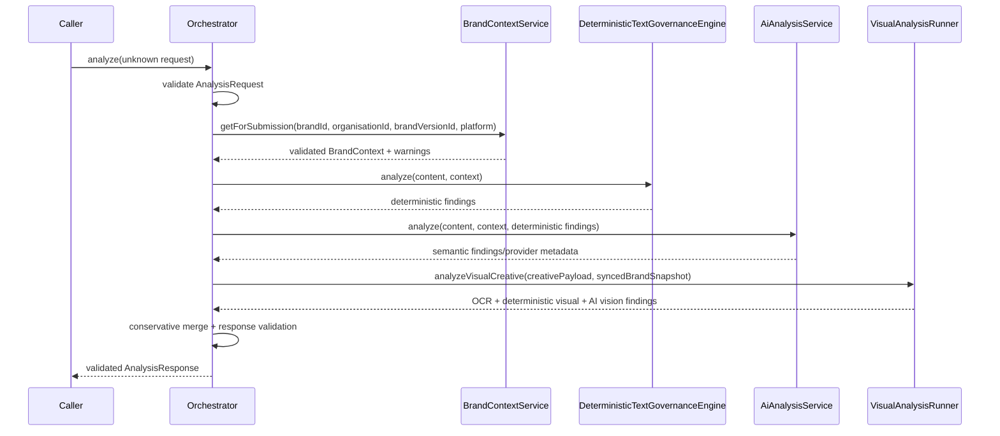

# Unified analysis orchestration

The [`lib/analysis`](../lib/analysis) module is the integration layer across
brand context retrieval, deterministic text & visual rules, AI text & vision
providers, and response contract validation.

## Architecture and execution sequence

`AnalysisOrchestrator` receives its services via constructor injection (or per-request factory resolution in [`composition-root.ts`](../lib/analysis/composition-root.ts)), enabling both production/API multi-brand execution and deterministic unit tests without network access.

## Live BrandContext & Visual Sync

When executing an analysis run:

1. `AnalysisOrchestrator` resolves `BrandContext` using `request.brandId`, optional `request.organisationId`, and optional `request.brandVersionId`.
2. Missing brands throw `BrandNotFoundError` (mapped to HTTP `404`), and cross-organisation requests throw `CrossTenantBrandAccessError` (mapped to HTTP `403`).
3. The resolved `BrandContext` (including approved colours, visual/typography guidelines, prohibited terms, approved guidelines, product facts, source IDs, and active `versionId`) is passed into both text engines AND synced directly into the visual creative analysis pipeline via `brandContextSnapshot`. Neither text nor visual analysis falls back to hardcoded brand rules.

## Finding combination

Deterministic findings are added first and therefore win when the same issue is
reported by both engines. An AI finding is considered a duplicate only when its
category and normalized issue match and it shares either the same reliable
location or the same evidence source/version/excerpt signature. Findings with
similar wording but different evidence or occurrences remain separate.

All findings retain their original evidence references, version IDs, locations,
provider names, and other contract fields. The final array is validated by
`AnalysisResponseSchema`.

## Errors and partial analysis

Invalid requests produce `InvalidAnalysisRequestError`. Brand retrieval,
deterministic, and AI failures produce `AnalysisOrchestrationError` with a
safe stage identifier and the original typed error in `cause`. AI failure is
never converted to an apparently clean response.

When `BrandContextService` returns retrieval warnings (for example missing
approved sections or `"NO_PUBLISHED_KNOWLEDGE"` on a brand with zero published
entries), or when visual OCR/vision encounters partial degradation, the
orchestrator returns `analysisStatus: "PARTIAL"` and forwards structured
`contextWarnings` / `visualExecution` metadata while preserving the canonical
response contract.

Final response validation failures are reported through
`AnalysisResponseValidationError`.
